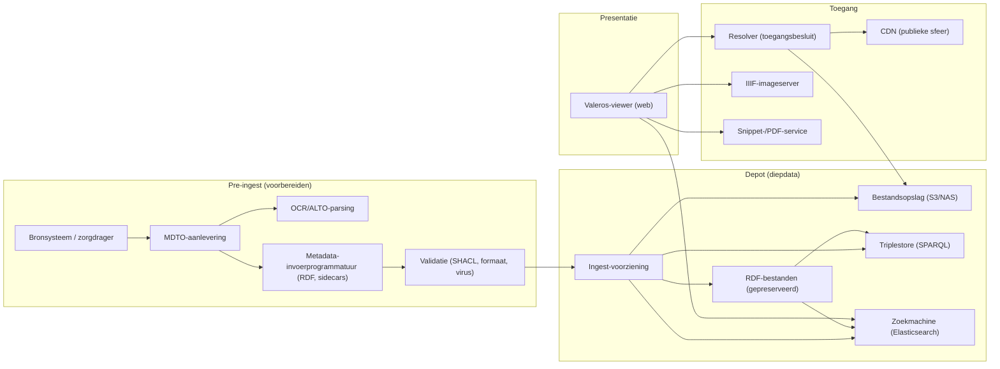
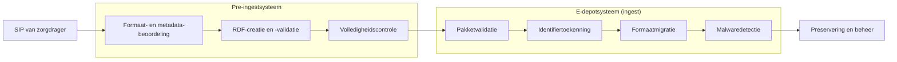
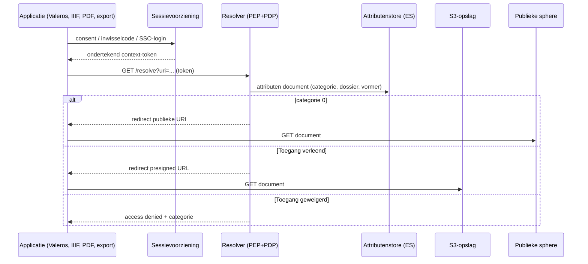

# ARIA

## E-depot Informatiearchitectuur | Versie 2026H2 (concept)

**Regionaal Archief Zuid-Utrecht** · November 2026 · Ter review

---

## 1. Inleiding

Dit document is de integrale actualisatie van de ARIA (Archiefbewaarplaats InformatieArchitectuur) versie 2023H1, waarin de voormalige *doelarchitectuur* is vervangen door de *gerealiseerde architectuur* van het RAZU e-depot.

Ten opzichte van 2023H1 is dit document ingrijpend ingekort. De strategische hoofdstukken (doelen, principes, eisen) zijn geactualiseerd en gecomprimeerd; de beschrijving van referentiearchitecturen (NORA, GEMMA, DERA, MARA) en de vergelijkingstabellen uit bijlage 2 van 2023H1 worden niet herhaald: de keuzes en interpretaties van toen zijn onverkort overeind. De nadruk ligt nu op wat er is gebouwd en hoe dat werkt, waar de nadruk in 2023H1 lag op wat er komen ging. Dit document is daarmee in de eerste plaats gericht op technische samenwerkingspartners en andere archiefinstellingen, en in de tweede instantie op het RAZU-bestuur.

Belangrijkste inhoudelijke wijzigingen ten opzichte van 2023H1:

- **MDTO is vastgesteld.** In december 2023 heeft het CIO-beraad van het Rijk het MDTO vastgesteld; de voetnoot in 2023H1 ("nog niet vastgesteld") is daarmee vervallen. Het RAZU stelt MDTO onverkort als uitwisselingsnorm.
- **Nieuw: eigen informatiemodel LDTO.** Intern hanteert het e-depot niet MDTO zelf, maar LDTO (*Linked Duurzaam Toegankelijke Overheidsinformatie*): een eigen, op RDF gebaseerde afsplitsing van MDTO die beter aansluit bij de manier waarop in RDF gemodelleerd wordt. Zie §2.1.
- **Uitgangspunt is nu de gerealiseerde architectuur**, niet de doelarchitectuur. Componentnamen volgen de praktijk (bijvoorbeeld *metadata-invoerprogrammatuur* (in de praktijk ook aangeduid als "metadata ingest tooling") in plaats van *ETL-component*).
- **RDF wordt actief gepreserveerd.** Alle RDF in de toegangslaag bestaat óók als bestand in de opslaglaag; het wordt niet ter plekke uit bronbestanden afgeleverd.
- **De zoekmachine is het centrale vindpunt.** De triplestore is bron voor verrijking en Linked Data-publicatie, maar de gebruiker vindt documenten via de zoekmachine.
- **Nieuw: toegangsbeperkingen (strevend).** De architectuur voor het afdwingen van beperkingen in openbaarheid en gebruik (AVG, Auteurswet, Archiefwet) is uitgewerkt in een eigen hoofdstuk, gebaseerd op het aparte ontwerp in de vestibulum-repository. Net als de pre-ingest/ingest-scheiding is dit nog ontwerp, geen gerealiseerde situatie (zie hoofdstuk 6).
- **Nieuw: pre-ingest/ingest-scheiding (strevend).** Tussen het voorbereiden van data (pre-ingest) en het daadwerkelijk laden van het depot (ingest) moet een strikte scheiding komen; de pre-ingest mag de diepdata straks niet meer rechtstreeks raken. Dit is een ontwerpkeuze die nog niet gerealiseerd is (zie §5.1).
- **Nieuw: open-sourceambitie.** Het RAZU wil het e-depot samen met andere archiefinstellingen en leveranciers als open-sourceproject doorontwikkelen.

## 2. Kaders en standaarden

Het e-depot is één van de weinige in de sector gerealiseerde e-depots die zijn ingericht volgens de visie van Common Ground. Dit hoofdstuk beperkt zich tot de kaders waaraan de architectuur zich aantoonbaar spiegelt: MDTO/LDTO, OAIS en Common Ground. Voor de overige referentiearchitecturen uit 2023H1 gelden de keuzes en interpretaties van toen onverkort (§2.4).

### 2.1 MDTO en LDTO

Het MDTO (Metagegevens voor duurzaam toegankelijke overheidsinformatie) is de norm voor de vastlegging en uitwisseling van metadata, opgesteld en beheerd door het Nationaal Archief. Het is in december 2023 vastgesteld door het CIO-beraad en vervangt TMLO en TMR definitief. Het RAZU adviseert zijn gemeenten ongewijzigd om op MDTO te sturen als voorbereiding op opname in het e-depot: MDTO is en blijft de **uitwisselingsnorm**.

Intern hanteert het e-depot echter niet MDTO zelf, maar **LDTO** (*Linked Duurzaam Toegankelijke Overheidsinformatie*): een RDF-ontologie die direct is afgeleid van MDTO en de MDTO-opzet nauw volgt, maar beter past bij de manier waarop in RDF gemodelleerd wordt, zoals het werken met URI's. Waar MDTO een data-uitwisselingsstandaard is, is LDTO vooral gericht op duurzame opslag van metadata in het e-depot. De afsplitsing stelt het RAZU in staat de standaard zelf te beheren en optimaal te laten meegroeien met de doorontwikkeling van het e-depot. Het informatiemodel is als **LDTO plus** gedefinieerd in een openbare repository ([Regionaal-Archief-Zuid-Utrecht/ldto](https://github.com/Regionaal-Archief-Zuid-Utrecht/ldto)): de LDTO-ontologie, SHACL-shapes voor validatie in drie strikteitsniveaus (core, plus, razu), en een gedefinieerde set uitbreidingen met andere ontologiën (zoals schema.org en PREMIS) plus verwijzingen naar eigen, door het RAZU beheerde thesauri.

De invoerprogrammatuur in de pre-ingest vertaalt MDTO-aanleveringen van zorgdragers naar LDTO plus; de SHACL-validatie controleert die vertaling (zie §5.2).

### 2.2 OAIS

Het OAIS-referentiemodel (ISO-standaard) is het enige kader waaraan de gerealiseerde architectuur zich direct en aantoonbaar spiegelt: het ingestproces (§5.2) is de uitwerking van de OAIS-functies *ingest* (SIP-normalisatie, validatie), *archival storage* (opslag in het e-depotsysteem) en *data management* (beheer via RDF-sidecars), en de toegang en de toegangsbeperkingen (hoofdstuk 6) dekken de OAIS-functie *access*. Waar 2023H1 OAIS nog als uitgangspunt formuleerde ("het e-depot maakt gebruik van het OAIS-model en ziet mogelijkheden om de functies te implementeren als componenten"), kan dit document constateren dat die vertaling inmiddels is gerealiseerd.

### 2.3 Common Ground

De informatiekundige visie van Common Ground blijft de ordening van het applicatielandschap leiden: ontkoppelde componenten met afgebakende functionaliteit, scheiding van gegevens en verwerking, en uitwisseling via REST API's. Het 5-lagenmodel (met de door het RAZU toegevoegde laag 0) is de leidraad voor de positionering van componenten in §5.3. Voor de uitwisselingslaag is de, in december 2024 door de Programmeringsraad GDI vastgestelde, FSC-standaard (Federatieve Service Connectivity, de opvolger van NLX) het huidige ijkpunt; voor het e-depot verandert dat aan de eigen architectuur weinig, omdat de koppelingen tussen de componenten al op REST en open standaarden (IIIF, S3, SPARQL) draaien.

### 2.4 Overige kaders

NORA, GEMMA, DERA, MARA en de FAIR-principes zijn in 2023H1 uitvoerig geplaatst en geïnterpreteerd (daar: hoofdstuk 2 en bijlage 2); die analyse wordt hier niet herhaald. De gerealiseerde architectuur is sindsdien niet opnieuw aan deze kaders getoetst. Voor een volgende actualisatie verdient het aanbeveling om expliciet te bezien in hoeverre de ingeslagen richting nog aansluit bij met name de DERA en de MARA, die inhoudelijk het dichtst bij het e-depot staan.

## 3. Doelen en principes

De vijf doelen en de vijf principes uit 2023H1 blijven onverkort de strategische koers. De functionering van het gerealiseerde e-depot wordt daaraan afgemeten; de architectuurbeschrijving in dit document is daarop ingericht. Woordelijke herhaling wordt achterwege gelaten; dit hoofdstuk vat ze als volgt samen, op één pagina:

| | Doel (2023H1) | Realisatie-controle (2026) |
|---|---|---|
| I | Het e-depot stelt de gebruiker centraal | Valeros-viewer; content-specifieke viewers (krant, kaart, adres, video); afgeleide formaten afgestemd op hergebruik |
| II | Het e-depot houdt informatieobjecten en metadata duurzaam toegankelijk | Originele staat in S3-opslag; RDF actief gepreserveerd; integriteitsvalidatie; S3-replica |
| III | Het e-depot biedt de collectie integraal en open aan | Eén zoekindex over alle materiaalsoorten; Linked Data-publicatie; IIIF voor afbeeldingen |
| IV | Het e-depot is flexibel en wendbaar | Ongekoppelde componenten; Valeros configureerbaar per materiaalsoort; Docker-containers overal inzetbaar |
| V | Het e-depot ontzorgt de RAZU-gemeenten | MDTO-aanlevering; inzageregels voor nog niet openbaar materiaal; zelfredzame ontsluiting |

| | Principe (2023H1) | Vertaalslag in de gerealiseerde architectuur |
|---|---|---|
| 1 | Vindbaar en aansluitend bij doelgroepen | Zoekmachine met OCR-fulltext; snippets; afgeleide formaten en viewers op maat per doelgroep; datamodellering per materiaalsoort, afgestemd op de gebruikers van dát soort informatie (geen one-size-fits-all) |
| 2 | Originele staat behouden | Bestandsopslag (S3) is de archiefopslag; afgeleiden (RDF, zoekindex, toegangskopieën) zijn kopieën |
| 3 | Informatieobjecten beschikbaar als Linked Data | RDF-sidecars; LDTO plus-ontologie (MDTO-afgeleide) op GitHub; triplestore; SHACL-validatie; eigen, in RDF opgebouwde thesauri en referentielijsten (op GitHub) die koppelen aan waardenlijsten van het NDE, zoals Wikidata |
| 4 | Ontkoppelde componenten met gestandaardiseerde interfaces | REST API's; losse microservices; alles open source of zelf gedraaid |
| 5 | Veiligheid in de kern geborgd | BIO; ontwerp toegangsbeperkingen-architectuur (hoofdstuk 6); beperkingen per document in RDF-sidecars gedocumenteerd |

## 4. Eisen

De nummering uit 2023H1 wordt aangehouden; alleen eisen die een wijziging of concretisering kennen, zijn opgenomen.

| # | Eisen | Status |
|---|---|---|
| 1 | Voldoen aan internationale/nationale normen (ISO 15489, ISO 16175, CoreTrustSeal, DUTO) | Onverkort |
| 2 | Voldoen aan de BIO | Onverkort. De BIO (Baseline Informatiebeveiliging Overheid) is het op ISO 27001/27002 gebaseerde basisnormenkader voor informatiebeveiliging binnen alle overheidslagen; de architectuur voor toegangsbeperkingen (hoofdstuk 6) vormt de concrete uitwerking van de BIO-thema's toegangsbeleid en vertrouwelijkheid voor het e-depot |
| 3 | Data opgeslagen bij Nederlandse aanbieder op Nederlands grondgebied | Onverkort |
| 4 | Voorkeur Nederlandse bedrijven; open voor EER/EVA | Onverkort |
| 5 | Klimaatimpact per component zo laag mogelijk | Onverkort |
| 6 | Uitwisseling op basis van REST API's | Onverkort (pas-toe-of-leg-uit) |
| 7 | Overheidsarchieven leggen we eenmalig vast | Onverkort (pas-toe-of-leg; zie §5.1 over afgeleiden) |
| 8 | Gebruik van open standaarden | Onverkort (pas-toe-of-leg: GitHub-standaarden, IIIF, MDTO, RDF/SPARQL, S3, Docker) |
| 9 | Voorkeur voor opensourcesoftware | Sterk verhoogd gewicht: zie §7, het e-depot wordt zelf als open-sourceproject gepositioneerd |

## 5. De gerealiseerde architectuur

Een kanttekening vooraf: dit hoofdstuk beschrijft de status van november 2026, maar niet alles wat hier staat is al in bedrijf. Het grootste deel van de opslaglaag, de zoekinfrastructuur en de presentatielaag draait; de **strikte scheiding tussen pre-ingest en ingest** (§5.2) en de **architectuur voor toegangsbeperkingen** (hoofdstuk 6) zijn ontwerp en streven, nog niet gerealiseerd. Waar dat zo is, staat het vermeld; de realisatieprioriteiten staan in hoofdstuk 7.

### 5.1 Lagen en loop van de data

De doelarchitectuur uit 2023H1 kende een driedeling: presentatielaag, toegangslaag, opslaglaag. De gerealiseerde architectuur voegt daar twee functionele vlakken aan toe die in de praktijk onmisbaar zijn gebleken:

- **Pre-ingest**: het voorbereiden en verrijken van aangeleverde data (vertaling van MDTO-aanleveringen naar LDTO plus, OCR-parse, afgeleide RDF opstellen, sidecars genereren).
- **Ingest**: het daadwerkelijk laden van het depot (bestanden naar S3, sidecars/RDF naar triplestore, index naar Elasticsearch, publicatiestatus instellen).

Er moet een **strikte waterscheiding** tussen beide komen: de pre-ingest-omgeving mag niet rechtstreeks in de diepdata van het depot kunnen schrijven; alle mutatie verloopt straks uitsluitend via de ingest-voorziening. Dit is de concretisering van het OAIS-onderscheid tussen ingest (opname) en data management (beheer), en het antwoord op de constatering dat de huidige praktijk, met losse scripts die direct in de diepdata schrijven, een aantastbaar en oncontroleerbaar geheel vormt. Belangrijk: dit is nog **doelarchitectuur, geen gerealiseerde situatie**. Vandaag verlopen de pre-ingest en de lading van het depot nog grotendeels door elkaar; het opzetten van de stricte ingest-voorziening is de eerste realisatieprioriteit (hoofdstuk 7).

Karakteristiek voor de gerealiseerde architectuur:

- **De opslaglaag omvat óók de RDF.** De RDF die de invoerprogrammatuur maakt, wordt als bestanden bewaard en actief gepreserveerd, niet ter plekke afgeleid. Dit is een belangrijk ontwerpbesluit: RDF is geen vluchtige afgeleide, maar een volwaardig, duurzaam te bewaren nevenproduct van het origineel.
- **De zoekmachine is het centrale vindpunt voor gebruikers.** De triplestore is bron voor verrijking, Linked Data-publicatie en directe SPARQL-raadpleging, maar elke interactieve zoektocht van de gebruiker loopt via de zoekmachine. Beide worden gevoed vanuit dezelfde RDF-sidecars, zodat er geen afwijkende kopieën ontstaan.
- **De presentatielaag is eenvoudig maar veelzijdig.** De Valeros-viewer (TypeScript, draait in Docker-containers) behandelt de front-end en bevat geen eigen logica voor toegangsbeperkingen of gegevensbeheer: die liggen in respectievelijk de resolver (hoofdstuk 6) en de RDF-sidecars. Per materiaalsoort wordt de viewer geconfigureerd: kranten (IIIF-manifesten + OCR), kaarten, adres-zoekfuncties, video, JSON/XML/PDF-viewers.
- **Geen one-size-fits-all in het informatiemodel.** Vindbaarheid per doelgroep begint bij de datamodellering: per materiaalsoort worden de metadata gemodelleerd op de manier die aansluit bij de vragen en het gebruik van de doelgroep van dát informatiesoort (bijvoorbeeld bouwdossiers anders dan kranten of luchtfoto's). LDTO plus ondersteunt dit met per-materiaalsoort uitbreidingen en SHACL-shapes, binnen één gemeenschappelijke kern.

### 5.2 Het ingestproces in vogelvlucht

De waterscheiding in het doelbeeld concreet: een aangeleverd SIP (Submission Information Package) wordt in de **pre-ingest** genormaliseerd en gevalideerd, en pas daarna door de ingest in het e-depotsysteem geladen. Vanaf dat moment ligt het pakket vast en start de lopende preservering.

De stappen in woord:

- **Formaat- en metadata-beoordeling** — beoordeling van bestandsformaten en metadata (o.a. tegen MDTO): wat is aangeleverd, is het interpreteerbaar en wat vergt dat voor preservering en raadpleging?
- **RDF-creatie en -validatie** — opstellen en valideren (SHACL) van de RDF-sidecars: beschrijving, context én toegangsbeperkingen (hoofdstuk 6).
- **Volledigheidscontrole** — is het pakket compleet en consistent (bestanden, metadata, sidecars)?
- **Pakketvalidatie** — de definitieve controle op het punt waar het pakket de waterscheiding passeert en het e-depotsysteem in gaat.
- **Identifiertoekenning** — toekennen van de persistente URI's, die later dienen als access-key via de resolver.
- **Formaatmigratie** — conversie waar dat voor duurzame toegankelijkheid of raadpleging nodig is; het origineel blijft behouden (principe 2).
- **Malwaredetectie** — virussen, malware en ransomware onderscheppen vóór opslag in het depot.

Na de ingest volgt de **preservering en het beheer**: het pakket (origineel, sidecars en afgeleiden zoals toegangskopieën) onderhouden, herclassificeren en duurzaam toegankelijk houden. De ingest stelt daarbij de publieke status van objecten expliciet in: publiceren bij categorie 0, intrekken bij een zwaardere categorie (zie hoofdstuk 6).

Dit proces is de praktijkuitoefening van het OAIS-model: de pre-ingeststappen vatten samen de OAIS-*ingest*-functie (normalisatie, validatie, SIP-verwerking), de ingest in het e-depotsysteem is de overdracht naar *archival storage* en *data management*, en de preservering en het beheer dekken de lopende *preservation planning* en *administration*.

### 5.3 Componenten en lagen volgens Common Ground

Op het Common Ground 5-lagenmodel (met de door het RAZU toegevoegde laag 0 voor opslag) is de gerealiseerde architectuur als volgt gepositioneerd:

1. **Laag 0 – opslag**: S3-compatibele objectopslag (Scalia; in de demo-omgeving SILO), NAS, verveelvuldiging/replica, IIIF-imageserver rechtstreeks op de opslag; Docker-containers voor de viewer.
2. **Laag 1 – Standaard informatiemodel**: het informatiemodel **LDTO plus** (op GitHub): de LDTO-ontologie (RDF-afsplitsing van MDTO), SHACL-shapes voor validatie op drie strikteitsniveaus, uitbreidingen met ontologiën als schema.org en PREMIS, en eigen, in RDF opgebouwde thesauri en referentielijsten (op GitHub) waarvan de concepten doorlinken naar gangbare waardenlijsten zoals die van het NDE (bijvoorbeeld Wikidata).
3. **Laag 2 – Gegevens**: RDF-sidecars in de opslag als bron van waarheid, inclusief de per document vastgelegde toegangsbeperkingen (type, termijn, einddatum, categorie).
4. **Laag 3 – Uitwisseling (FSC)**: REST-API's; IIIF voor beeld; presigned URL's en publieke URI's voor uitgifte (hoofdstuk 6); SURA voor URI-naar-URL-resolutie.
5. **Laag 4 – Applicaties/verwerking**: Valeros (viewer), snippetserver, PDF-generatie (Gotenberg), metadata-invoerprogrammatuur, OCR/ALTO-parser (Python), es-indexer.

Deze indeling maakt de twee eerder genoemde eigenschappen zichtbaar: de invoerprogrammatuur is het spilpunt tussen laag 2 en de diepe opslag (en hoort functioneel bij de ingest-functie), terwijl de viewer en de invalsservices in laag 4 zitten en de resolver functioneel in laag 3 zit.

## 6. Toegangsbeperkingen

Dit hoofdstuk vat de architectuur voor het afdwingen van beperkingen in openbaarheid en gebruik samen; de volledige uitwerking, inclusief requirements en open punten, staat in de vestibulum-repository (`architectuur-toegangsbeperkingen.md`). Net als de waterscheiding uit §5.1 is dit **ontwerp en streven**: de beveiligde opslagniveaus zijn nog niet in bedrijf; de implementatie volgt op de afronding van de ingest-voorziening (hoofdstuk 7). Beperkingen worden op dit moment wel degelijk vastgelegd en afgedwongen, maar nog niet langs de in dit hoofdstuk beschreven gecentraliseerde route.

### 6.1 Categorieën en context

Elk document heeft een **basiscategorie**:

| Categorie | Betekenis | Vereiste context |
|---|---|---|
| 0 | Publiek | geen |
| 1 | Alleen na instemming met voorwaarden (persoonlijke kopie) | `consented` (per dossier) |
| 2 | Alleen in de studiezaal | `studyroom` |
| 3 | Alleen na individueel verleende toegang | `granted` (scope-specifiek) |

Toegang stapelt zich: wie op meer gronden toegang heeft, krijgt de ruimste combinatie. Een `granted`-toegang geldt uitsluitend voor de scopes waarvoor hij is verleend (bijvoorbeeld "alle documenten van archiefvormer X" of "alle bouwtekeningen van gemeente Y").

### 6.2 Componenten en rollen

Het ontwerp volgt de XACML-rolverdeling (NIST SP 800-162), bewust eenvoudig gehouden:

- **Resolver** (PEP): het enige punt waar een toegangsbesluit wordt genomen, de enige route voor afgeschermde documenten. Gebaseerd op SURA (URI → besluit → URL).
- **Beslislogica** (PDP): module binnen de resolver; de policy (categorieënmatrix, stapeling, scope) bestaat op precies één plek.
- **Sessievoorziening**: stelt en ondertekent context-tokens; zonder eigen status of gebruikersdatabase; `granted`-context komt ofwel via SSO (OIDC: Entra ID, Keycloak, SURFconext) met een vertaaltabel van claims naar scopes, ofwel via een inwisselcode voor tijdelijke verleningen.
- **Autorisatieregister**: de verleende `granted`-toegangen; gevuld door beheerprocessen, gelezen door de sessievoorziening.
- **Attributenstore**: per document een attributenrecord (categorie, dossier, archiefvormer, bucket/key), gematerialiseerd uit de RDF-sidecars in een snelle store (de bestaande Elasticsearch-index), bijgewerkt door het inname- en herclassificatieproces.
- **RDF-sidecars (PIP/PAP)**: bron van waarheid voor beperkingen en categorieën, beheerd door de archivaris.

### 6.3 Kerngaranties

- **Alle uitgiftekanalen lopen samen langs één punt: de resolver**: webweergave, IIIF-tiles, PDF-generatie, snippets en export gebruiken identiek dezelfde route.
- **Slechts documenten met categorie 0 zijn publiek leesbaar.** Dit wordt afgedwongen in het classificatieproces en de opslagconfiguratie (buckets per archiefvormer, default-deny, expliciete publicatie bij herclassificatie naar 0) en geverifieerd door een periodieke controle die feitelijke leesbaarheid met de geregistreerde categorie vergelijkt.
- **Verlooptermijnen worden automatisch toegepast**: een jaarlijks herclassificatieproces zet verlopen beperkingen om naar ruimere categorieën en publiceert of intrekt dienovereenkomstig.
- **Toegang geweigerd is het begin van een route**: naar instemming (cat 1), de studiezaal (cat 2), de aanvraagroute bij de archivaris (cat 3), of een bestaande publieke toegangskopie.
- **Eén auditlog**: elk verzoek aan elk document passeert de resolver en wordt gelogd.

Open punten ([NTB], zie het architectuurdocument in vestibulum): metadata-bescherming versus niet-indexeren, per-object ACL versus publieke prefix, de vorm van medewerkers-tokens, en de decentrale koppeling voor gebruikersbeheer van deelnemende gemeenten.

## 7. Doorontwikkeling en open-sourceambitie

De voortgang staat in het teken van drie prioriteiten:

1. **Afronding van de ingest-voorziening.** Het werk dat nu nog met losse scripts in de pre-ingest gebeurt (met name OCR-parsering en sidecar-generatie), verhuist naar een degelijke, strikte ingest-voorziening met bijbehorende logging en validatie (SHACL, formaat, virus, integriteit).
2. **Implementatie van de toegangsbeperkingen** conform hoofdstuk 6, met de resolver als eerste bouwsteen (voortbouwend op SURA) en de attributenstore en herclassificatieproces als tweede.
3. **Open-sourceproject met partners.** Het RAZU wil het e-depot (viewer, invoerprogrammatuur, ontologie, SHACL, documentatie, roadmap) samen met andere archiefinstellingen en/of leveranciers van collectiemanagementsystemen als open-sourceproject doorontwikkelen. Voorwaarde om te starten is een aantrekkelijke, degelijke publieke basis (repo's, zelf draaibare demo zoals de Valeros-demo, licentie en governance); leveranciers adopteren eerder dan dat ze meebouwen, dus ook de leveranciersroute is een te overwegen alternatief of aanvulling. Voor de volgende actualisatie van dit document is het governance-model van dat samenwerkingsproject dan ook mede-onderwerp.

Daarnaast: de huidige teamcapaciteit (twee personen) is voor deze doelen onvoldoende; een gezamenlijk open-sourceproject met gedragen roadmap is tevens het middel om die capaciteitsgrens te doorbreken.

## 8. Begrippenlijst (selectie)

| Begrip | Definitie |
|---|---|
| BIO | Baseline Informatiebeveiliging Overheid: het op ISO 27001/27002 gebaseerde basisnormenkader voor informatiebeveiliging binnen alle overheidslagen |
| Pre-ingest | Het voorbereiden van aangeleverde data (validatie, verrijking, afgeleide RDF, sidecars) vóór opname in het depot |
| Ingest | Het daadwerkelijk laden van het depot: bestanden naar S3, RDF naar triplestore en opslag, index naar Elasticsearch, publicatiestatus instellen |
| Waterscheiding | De beoogde strikte scheiding tussen pre-ingest en ingest (nog niet gerealiseerd): de pre-ingest mag straks niet rechtstreeks in de diepdata schrijven |
| SIP | Submission Information Package: het pakket van bestanden en metadata zoals aangeleverd door de zorgdrager, vóór normalisatie in de pre-ingest |
| LDTO / LDTO plus | Linked Duurzaam Toegankelijke Overheidsinformatie: de eigen, direct van MDTO afgeleide RDF-ontologie van het RAZU e-depot; "plus" duidt de gedefinieerde uitbreidingen met andere ontologiën en thesauri aan |
| Thesauri en referentielijsten | Eigen, in RDF opgebouwde lijsten van beheerde begrippen (op GitHub), waarvan de concepten doorlinken naar gangbare waardenlijsten zoals die van het NDE (bijvoorbeeld Wikidata) |
| Metadata-invoerprogrammatuur | De scripts en programma's die MDTO-aanleveringen vertalen naar het RAZU-informatiemodel (LDTO plus) en de RDF-sidecars; opvolger van het "ETL-component" uit 2023H1 |
| RDF-sidecar | RDF-bestand naast het origineel in de opslag; bron van waarheid voor metadata én toegangsbeperkingen |
| Resolver | De voorziening (op basis van SURA) die per verzoek het toegangsbesluit neemt (PEP+PDP) en vertaalt naar een publieke URI of presigned URL |
| Context-token | Kortlevend, door de sessievoorziening ondertekend token dat het context-niveau (`consented`, `studyroom`, `granted`) van de gebruiker aantoont |
| Attributenstore | Per document gematerialiseerd attributenrecord (categorie, dossier, archiefvormer, opslaglocatie) voor snelle beslisvoorziening |
| Basiscategorie | Classificatie van een document in categorie 0 (publiek) t/m 3 (individueel verleend), vastgelegd in de RDF-sidecar |
| SURA | De RAZU-voorziening die persistente URI's naar URL's vertaalt en token-generatie verzorgt; fundament van de resolver |

## Colofon

ARIA – E-depot Informatiearchitectuur, versie 2026H2 (concept, ter review). Opvolger van ARIA 2023H1 (feb. 2023, bijlage 6.2 bestuursvergadering RAZU 5 april 2023). Verwerkte bronnen: ARIA 2023H1; het RAZU e-depot documentation-wijzigingsvoorstel (RV, 2026-01-15); het vestibulum-ontwerp architectuur-toegangsbeperkingen (2026-11-20) en de gelinkte requirements; de Valeros-RAZU-repository; interne notities over architectuur, pre-ingest/ingest-scheiding en open-sourceplannen.

Regionaal Archief Zuid-Utrecht · Karel de Grotestraat 30, Wijk bij Duurstede · https://www.razu.nl